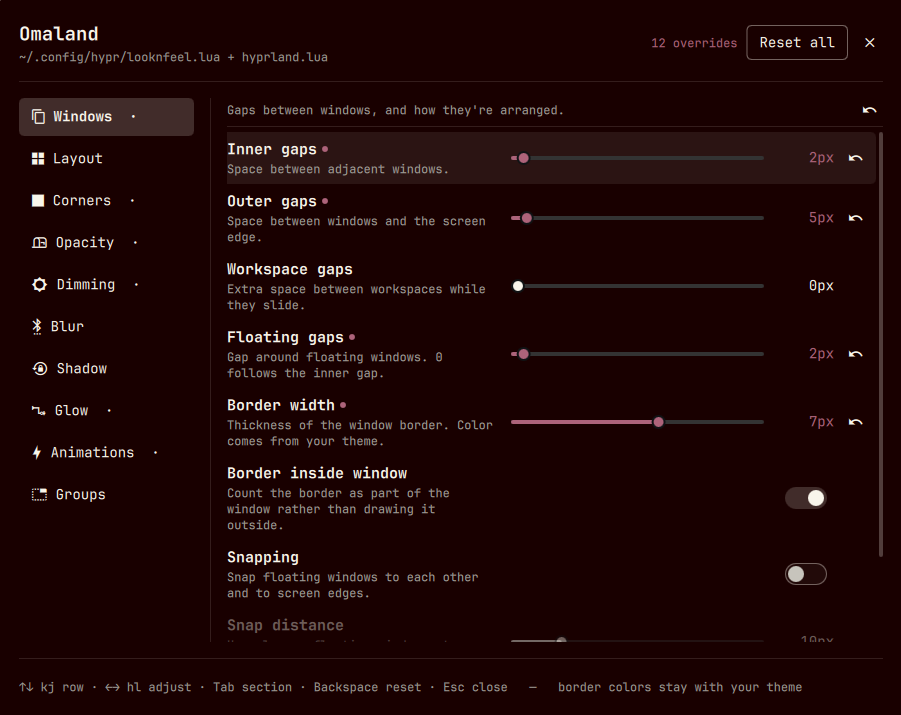

<div align="center">


# Omaland

**A GUI for Hyprland's visual look and feel.**

An Omarchy shell plugin. Applies live as you drag,
and saves plain Lua into your Hyprland config.


<br><br>



</div>

## Install

```bash
omarchy plugin add https://github.com/bobby-nicholas/omaland.git --enable --yes
```

Open it from **SUPER+SPACE › Omaland**. No network access, no sudo.

To remove it, `omarchy plugin remove bobbynicholas.omaland --yes`. Your settings
stay — they are plain Lua in the files Hyprland already reads. Hit **Reset all**
first to undo them too.

## What it edits

| Section | Options |
|---|---|
| **Windows** | gaps in/out/workspaces/floating, border width, border inside window, snapping |
| **Layout** | tiling engine, plus the active engine's own knobs (`dwindle:*`, `master:*`, `scrolling:*`) |
| **Corners** | rounding, roundness curve |
| **Opacity** | full opacity, focused, unfocused, fullscreen, opaque apps stay opaque |
| **Dimming** | dim unfocused, strength, special workspace, dim around, dim behind modals |
| **Blur** | enabled, size, passes, noise, contrast, brightness, vibrancy, x-ray, special, popups |
| **Shadow** | enabled, range, falloff, scale, sharp |
| **Glow** | enabled, range, falloff |
| **Animations** | enabled, wrap workspaces, speed multiplier |
| **Groups** | group bar height, font size, titles, indicator, rounding, gradients, stacked |

Colors are absent on purpose: Omarchy themes own `general:col:*` from a file
that loads before `looknfeel.lua`, so writing them here would pin your borders
and break `omarchy theme set`.

## Keys

| | |
|---|---|
| `↑` `↓` / `k` `j` | move between rows |
| `←` `→` / `h` `l` | adjust the current row |
| `Tab` / `Shift+Tab` | next / previous section |
| `Space` `Enter` | toggle |
| `Backspace` | reset the row to the Omarchy default |
| `Esc` | close |

## How it works

**Where it writes.** One fenced block per file — `hl.config` and `hl.animation`
in `looknfeel.lua`, `o.window` rules in `hyprland.lua`. Nothing outside the
fences is touched, and clearing every override removes the blocks and restores
both files exactly.

**Reading state back** is done by Lua, not by a parser. `read.lua` runs the
block against recording stubs for `hl` and `o` and reports what it set, so the
block stays pure Lua with no state comments, and a hand-edit that breaks the
syntax gets a real error instead of being silently misread. Needs `lua`, which
`hyprland` already depends on.

**Live preview** uses `hyprctl eval` (Hyprland's Lua parser rejects `hyprctl
keyword`), handed the same Lua that gets written on release, so preview and
saved state can't drift. `hyprctl configerrors` runs after every write and
surfaces in the footer.

**The shell follows along.** The Omarchy shell mirrors rounding and outer gaps
into its own menu, notifications and panels. Omarchy 4.5 re-reads them whenever
Hyprland reloads, which covers a save; a live preview doesn't reload, and 4.0
only re-read at startup and on a theme change. Omaland asks it to re-read after
every preview and save, so the whole interface tracks the sliders, not just the
windows.

**Omarchy's Appearance presets win, and Omaland says so.** Window Corners,
Window Gaps Off, Glassy windows or bar, Animations Off and the default
Workspace Layout are files Omarchy loads after `looknfeel.lua`, so whatever
they set beats Omaland's block. While one is on, the options it holds are
locked in Omaland, show the live value, and name the menu item that holds
them; switch it back there and your Omaland values return untouched. Which
options a preset holds is read from Omarchy's own copy of the preset, never
from a list kept here, so new presets are covered as Omarchy adds them.

**The launcher entry** is installed by the plugin, because Omarchy has no
install hook. Enabling writes `~/.local/share/applications/omaland.desktop`;
disabling or removing deletes it. Only a file carrying `X-Omaland-Managed=true`
is ever touched, so your own entry at that path is left alone. The plugin's own
directory is resolved from `Qt.resolvedUrl()` rather than from the manifest:
Omarchy 4.0.4–4.0.6 stripped `__sourceDir` from the manifest it hands
third-party plugins, and a file's own URL works on every version.

**Full opacity** clears Omarchy's `opacity = "0.985 0.96"` rule, which
multiplies with the opacity sliders, so without it 100% still renders at
0.985. On Omarchy 4.5 the switch *is* **Appearance › Window Opacity ›
Opaque**: Omaland drives Omarchy's own command, so the Omarchy menu agrees and
floating workspaces keep their windows solid. On 4.0 it writes the rule
itself.

**Opaque apps stay opaque** keeps the sliders off the windows Omarchy means to
be solid, because the sliders multiply into every window. Omaland keeps no app
list of its own; it follows Omarchy's tags, and the block asks at load time
which model the installed Omarchy uses, so it stays right across an upgrade:

- **4.5:** apps are opaque unless Omarchy makes them see-through (terminals,
  and anything you add with `o.transparent_window("my-app")` in
  `looknfeel.lua`, or with Super + Backspace). The sliders reach only those.
- **4.0:** video players, image viewers, games, VMs and picture-in-picture,
  the apps Omarchy exempts from its translucency, ignore the sliders.

It is on by default and writes nothing until a slider drops below 100%. The
windows are pinned with `override`, so the sliders skip them.

**Blocks from older Omaland versions are updated once, automatically.** Omaland
versions from before Omarchy 4.5 wrote media rules that pin every window on
4.5, and a Full opacity rule that undoes floating workspaces' opacity. When the
plugin loads it rewrites just those lines of its own block, and carries Full
opacity over as Omarchy's Opaque mode unless you already chose a mode there.

<details>
<summary>Reaching it from the Omarchy menu as well</summary>

Add this to `~/.config/omarchy/extensions/omarchy-menu.jsonc` to put it under
**Appearance › Windows**, next to Omarchy's corner and opacity presets:

```jsonc
"appearance.windows.omaland": {"icon":"󰸌","label":"Visual Editor","aliases":["omaland","looknfeel"],"action":"omarchy-shell shell toggle bobbynicholas.omaland"},
```

Omarchy 4.0 called that menu **Style**, with no Windows submenu; use
`"style.omaland"` there. A snippet that names a menu Omarchy has since renamed
is dropped silently, so check it after an Omarchy upgrade.

</details>

## Development

```
manifest.json    plugin declaration (kinds: panel, service)
Panel.qml        state, hyprctl processes, file IO, layout
OptionRow.qml    one option row
Schema.js        the option catalogue
LuaConfig.js     render the managed blocks, read read.lua's output
Paths.js         locate the plugin's own directory from a QML file's URL
read.lua         runs a block against recording stubs to report what it set
Service.qml      installs and removes the launcher entry
test/run.js      node test/run.js
```

Adding an option is one entry in `Schema.js`. Plugin QML is cached by URL, so
edits need `omarchy restart shell`.

## License

MIT
